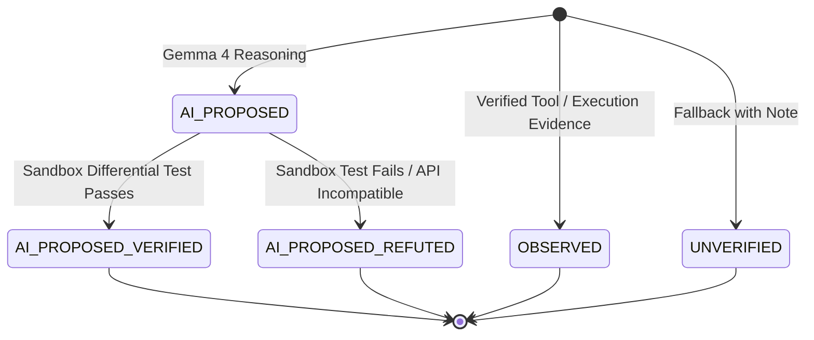

# The Sacred Trust Ledger

> **Tagline:** *"Don't trust the AI's migration plan. Trust the receipt."*

ExitKit is built on a single, uncompromising principle: **LLMs propose ideas, but real code executions produce facts.** 

When an engineering team migrates a mission-critical dependency—like moving from unmaintained `appdirs` to `platformdirs`, or breaking away from vulnerable `Jinja2 2.x`—they cannot rely on an AI's hallucinated promises. They need verifiable proof that code actually compiled, imports actually resolved, and test suites actually passed.

The **Trust Ledger** is ExitKit's cryptographically verified audit trail. Every claim, hypothesis, and finding inside a Dependency Exit Capsule is tagged with an explicit trust level.

---

## 1. The Five Trust Levels

| Trust Level | Origin | Description | Evidence Requirement |
| :--- | :--- | :--- | :--- |
| `OBSERVED` | Real Tool Execution | Concrete facts gathered by running tools (e.g. package managers, AST parsers, HTTP API queries, test runners). | **Strictly required**: must point to an on-disk evidence artifact whose SHA-256 hash matches exactly. |
| `AI_PROPOSED` | Gemma 4 Inference | Hypotheses, migration steps, compat shims, or replacement rankings generated by the model. | Must be accompanied by `ModelInfo` (model ID, backend, access method, timestamp). |
| `AI_PROPOSED_VERIFIED` | Sandbox Test Execution | An `AI_PROPOSED` claim that ran through the isolated sandbox test suite or differential tests and **passed completely**. | Non-empty evidence IDs pointing to execution logs, plus explicit link to the original proposed claim. |
| `AI_PROPOSED_REFUTED` | Sandbox Test Execution | An `AI_PROPOSED` claim that ran through the isolated sandbox and **failed or broke compatibility**. | Non-empty evidence IDs documenting the exact error, plus explicit link to the original proposed claim. |
| `UNVERIFIED` | Fallback / Human | A statement that could not be evaluated by tools or verified by tests. | Must include an explicit note explaining why verification was impossible. |

---

## 2. Allowed Transitions

Claims never mutate in place. State transitions create new, immutable claim records that link back to their predecessors via `supersedes`.

### The Invariant Rules of Trust
1. **The ONLY legal transitions** are `AI_PROPOSED -> AI_PROPOSED_VERIFIED` and `AI_PROPOSED -> AI_PROPOSED_REFUTED`.
2. An AI proposal can **never** be promoted directly to `OBSERVED`. An observed fact is born only from real execution receipts.
3. An `OBSERVED` claim can **never** be downgraded or altered.
4. A refuted claim can **never** be resurrected or re-verified.

---

## 3. Why `OBSERVED` Requires Hash-Pinned Evidence

In ExitKit, you cannot claim a package is broken, compatible, or vulnerable simply because a prompt said so. 

Every `OBSERVED` claim must reference one or more content-addressed artifacts in the capsule's `evidence/` directory:
- PyPI API responses
- OSV vulnerability queries
- AST syntax trees and call-site snippets
- Subprocess stdout/stderr logs from `uv pip install` or `pytest`

When a capsule is verified, ExitKit recalculates the SHA-256 checksum of every referenced evidence file. If even a single byte has been modified, tampered with, or truncated, the entire capsule is rejected with an integrity error.

---

## 4. Why Refuted Claims Are Kept (A Feature, Not a Bug)

Most AI code-generation tools sweep errors under the rug: if a generated snippet fails, they quietly regenerate it or crash. 

ExitKit does the opposite: **`AI_PROPOSED_REFUTED` claims are preserved permanently in the capsule alongside the receipts that disproved them.**

Why this matters to engineering teams:
- **Negative Knowledge**: Knowing that *"Replacing library X with library Y broke method Z with TypeError"* saves future developers from making the exact same migration mistake.
- **Hallucination Defense**: Proves that the verification pipeline actually caught the model when it hallucinated an imaginary parameter or incompatible API.
- **Transparent Auditing**: Security reviewers can see exactly what the AI got wrong and verify that the final capsule only uses passing, verified solutions.
